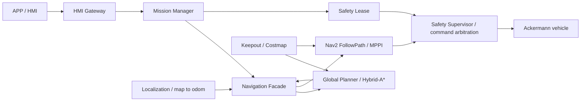

# CleanNav Navigation — R8-A4 Patrol Path Split

CleanNav is a ROS 2 Humble navigation stack for an Ackermann cleaning vehicle. This repository owns Navigation, its Facade, Planner/Path Executor adapters, and the source snapshots of the R7-RC MPPI and R7-A2 Costmap used by R8-A4. Mission Manager, Safety Supervisor, HMI Gateway, localization, simulation and deployment assets form the surrounding system; their responsibilities are distinct from navigation planning and control.

**Validated scope:** R8-A4 completed **one full simulated PATROL lap** on 2026-11-06. Both inner FollowPath actions, outer FollowPath, Mission Manager and APP sequence succeeded with `completed_steps=2/2`. This is not multi-lap statistical robustness or real-vehicle validation. R9 route geometry optimization is not implemented.

Candidate identity: `6785d5a3b98447606d52b2cdb9b4600d5fb2b7416f852f3dcef37cd8033e68f5`. The candidate identity identifies the frozen installed experiment; Git commits identify this source recovery. Recompiled binaries are separately identified and are not asserted byte-identical or newly dynamically validated.

## Architecture and capabilities



The stack supports Hybrid-A* planning, constrained Ackermann MPPI, GOTO, closed-loop PATROL split into successive FollowPath goals, sequence orchestration, real Safety Leases and strict Keepout constraints. Facade owns action admission, path validation, replanning and action lifecycle; it does not grant Safety permission. Path Executor provides the separate execution adapter. Mission Manager owns sequence progress. Safety arbitrates final commands and controlled stopping; Gateway bridges application requests into the existing task interface.

R8-A4 changes only the closed-loop split selection relative to its A2 runtime parent. It prefers a distant endpoint with a straight incoming metre, checked against the final segment tangent within 1cm, and preserves legacy fallback and interfaces. The frozen route computes index **932**, reversed route **751**; these are test results, not algorithm constants. MPPI algorithms/parameters, route generation, maps, Registry, Safety and external interfaces remain frozen.

## Source layout

- `cleannav_navigation/`: exact runtime Python modules, config/launch, Boundary and Bounded plugin sources, CMake/package definitions.
- `vendor/nav2_mppi_controller/`: full R7-RC source snapshot, not unmodified upstream MPPI.
- `vendor/nav2_costmap_2d/`: full A2 timestamp-consistent Costmap snapshot.
- `vendor/cleannav_interfaces/`: exact installed message/service/action definitions; generated code is built locally.
- `cleannav_global_planner/`, `cleannav_path_executor/`: recovered running Python sources and package metadata.
- `tests/patrol/`: 166 source-only regression cases and small provenance-bound geometry fixtures.
- `provenance/R8_A4_SOURCE_MAP.json`: historical installed SHA → original source → Git path → install rule mapping.

## Checkout, environment, build and tests

Use Ubuntu 22.04, ROS 2 Humble and Python 3.10, matching the validated WSL2 environment. C++ dependencies include Nav2 1.1.20-era packages, pluginlib, tf2, xtensor/xsimd and ROSIDL; package.xml files are authoritative. CPU-specific compilation and system library versions affect binary reproducibility. Do not substitute upstream MPPI/Costmap for the vendored revisions.

The geometry regression has no ROS dependency:

```bash
python3 -m pytest -q tests/patrol
```

ROS packages require the declared ROS dependencies and reviewed CleanNav underlays. Build using the existing single-thread, resource-supervised `safe_colcon_build.sh` workflow; do not run an unrestricted colcon build. Exact workspace layout, source order, commands and build receipts are in [Development Guide](docs/DEVELOPMENT_GUIDE.md). Unit tests load checkout source; installed ROS message packages are dependencies, not the implementation under test.

A checkout supplies maintainable sources and regression fixtures. Reproducing the historical dynamic experiment additionally requires the identified frozen map/world/model/Registry/route and external component installations. Large maps/DB/bags and historical local install trees are deliberately not shipped as source. The validated candidate and consumed session are evidence, not reusable run authorization.

## Running

The proven PATROL workflow is to enter a **fresh independently bound session directory** and execute:

```bash
bash run_patrol_lap.sh
```

Keep the existing runner's checks and source/export order; do not source overlays or export the target Domain outside it. The historical runner/Observer are retained as evidence; their consumed IDs, ports, database and authorization must never be replayed. No new runtime wrapper is introduced. See the complete [Operations Runbook](docs/OPERATIONS_RUNBOOK.md), including readiness, FD9/SID locks, single submission, Lease and cleanup. Development unit tests and historical experiments are separate workflows.

## Validation and limitations

The original installation passed 166 offline tests, including 132 rephased-start/direction cases. This release runs the same assertions against source. The dynamic run recorded the original 1649-point input, two inner successes, outer success and MM/APP success. Optimizer failure, Localization/Security LOST, protective ESTOP and Keepout-core 253 counts were zero. Final stopping, Lease release, owned-process cleanup and map SHA preservation passed.

The split index is deterministically reconstructed from the pinned module and recorded path; raw action goal payloads were not recorded. GOTO succeeded as a business action but its stopping distance to entry was about 0.505m with the existing stateful checker; this is not instantaneous 0.30m accuracy. Unreadable foreign process environments and cgroup resource completeness remain UNKNOWN. Continuous curves may use legacy split fallback; arbitrary-route terminal reachability is not guaranteed.

## Documentation

- [Architecture](docs/README_ARCHITECTURE.md)
- [Development and build](docs/DEVELOPMENT_GUIDE.md)
- [Operations Runbook](docs/OPERATIONS_RUNBOOK.md)
- [Safety and recovery](docs/SAFETY_AND_RECOVERY.md)
- [R8-A4 algorithm decision](docs/decisions/R8_A4_PATH_SPLIT.md)
- [Dynamic result](docs/validation/R8_A4_DYNAMIC_RESULT.md)
- [Validation history and remaining work](docs/VALIDATION_HISTORY.md)
- [Historical report archive and sources](docs/experiment-archive/r8-a4/SOURCES.json)

License: [Apache 2.0](LICENSE), with upstream notices retained in vendored files and MPPI's LICENSE.md.
