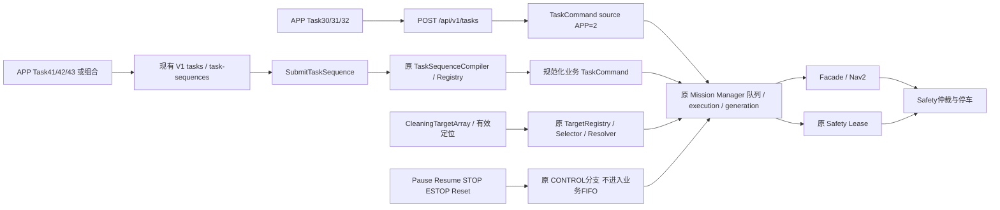

# V1 Task Catalog / APP 模式现状与最小计划

**READ-ONLY AUDIT / NO MODE CODE CHANGE**。本审计在R9单圈动态PASS和原始bag/报告SHA归档后开始。没有运行Task30/31/32/43、控制操作、额外POST/Lease/速度或第二次巡航；未修改V1 API、Task ID、Catalog、MM、Safety、Navigation或Flutter源码。

## 1. 事实来源与版本

事实优先取本次实际加载的安装版：GoalChecker Interfaces r1 的 `share/cleannav_interfaces/config/task_catalog.yaml`、A2/R8实际Mission Manager安装的node/simulation_runner/sequence compiler/core、e2e Gateway安装版的http_server/app_contract/mission_bridge/status_cache。每个实际路径与SHA见 [mode-audit-source-index.json](validation/r9-dynamic/evidence/mode-audit-source-index.json)，[实际Catalog快照](validation/r9-dynamic/evidence/task_catalog.actual.yaml)。这些是运行事实来源，不把install当作新可维护源码owner。

Flutter源码owner是独立Git仓库 `cleannav-hmi`，main HEAD `6ddff0f88e200136f2462e42e50aaaccab2d3aa6`，pubspec版本0.2.0+1。它有既存Gateway相关dirty/untracked文件，完整 [Git状态](validation/r9-dynamic/evidence/hmi-audit-git-before.json) 保留，未暂存/修改/提交；不能只用HEAD声称整个工作树clean。审计的Flutter tracked文件也逐文件记录SHA。没有执行手机构建或真机APP点击验证。

`docs/app/README.md` 和openapi记录的是V1 HTTP能力；实际Flutter界面/transport仍是较早比赛版。两者必须区分，不能用V1文档代替手机实现证明。

## 2. 六个业务任务的实际状态

| Task | 分类 | Catalog / V1入口 | 实际调度与限制 | 当前Flutter | 验证结论 |
|---|---|---|---|---|---|
| 30 CLEAN_NEAREST_LEAF | 视觉定点清扫：落叶 | enabled=true；POST /api/v1/tasks，TaskCommand | TargetRegistry按LEAF筛选NEAREST_VALID；有效map定位+未过期目标；无目标PendingGoal，等待10s后305；返回目标中心PoseStamped并沿原Nav/Safety链执行 | tasks列表唯一Task30；旧/api/tasks | 接口、选择/等待/导航源码已存在；本次未发30，感知产物/清扫机构实际完成未验收 |
| 31 CLEAN_NEAREST_LEAF_PILE | 视觉定点清扫：落叶堆 | enabled=true；同TaskCommand入口 | LEAF_PILE，同选择与等待流程；Catalog completion_radius_m=.40 | 无任务卡入口 | 源码/接口已存在，不等于本场景端到端清扫PASS |
| 32 CLEAN_NEAREST_PUDDLE | 视觉定点清扫：积水 | enabled=true；同TaskCommand入口 | PUDDLE，同流程；Catalog completion_radius_m=.40 | 无任务卡入口 | 源码/接口已存在；吸水/清扫硬件执行及完成契约未验证，不能仅改标签宣布实现 |
| 41 GOTO_REGION | 区域导航子任务/动作 | enabled=true；V1单步任务或Typed Sequence operation1 | 绑定map identity与Registry.region.entry_pose，导航到具名入口 | 无V1区域导航页面/提交方法 | 本次R9 GOTO实际SUCCEEDED；终态入口误差约.549m，stateful checker，非瞬时.30m精度认证 |
| 42 PATROL_REGION | 规则场地贴边巡航模式 | enabled=true；V1单步或Sequence operation2 | Registry含path_file时，每圈一个稠密PathNavigationGoal；Facade以冻结A4分成两段FollowPath；旧无path_file时才逐checkpoint导航 | 无巡航卡、Typed Sequence提交或Sequence快照模型 | R9固定生产路径起点/ccw/C1.344m/A4执行链完整单圈PASS；其他范围未验证 |
| 43 RETURN_CHARGER | 返充导航动作（非充电控制） | enabled=true；V1单步或Sequence operation3 | 查Registry.charger.staging_pose，仅导航，不自动对接/充电；本次Registry chargers=[]，不存在可执行目标，原编译器应返回CHARGER_NOT_FOUND221 | 无返充卡/Sequence入口 | 接口/编译器存在，当前站点未配置，动态NOT RUN，不得作为可用返充或充电功能展示 |

Catalog30 completion_radius_m=.35，31/32=.40是既有policy配置，不代表本次已测清扫覆盖半径。实际simulation_runner调用 `create_visual_real_runtime` 并订阅 `/cleannav/simulation/cleaning_targets` 与 `/cleannav/simulation/localization_pose`；桥/选择器可用并不证明实际感知生产者、目标精度、扫刷/吸水机构或目标清除判定已跑通。其docstring明确复用普通Nav2结果，不采用demo专用完成逻辑；不能把导航SUCCEEDED直接解释为物理垃圾/积水已清除。

Task33优先级选择仍disabled（缺priority contract）；1默认清扫、5旧RETURN_HOME、10固定点、20固定路线均disabled；Task40是RViz专用显式位姿入口，不是APP可随意给pose的模式。它们本轮全部保持不变，不擅自开放。

## 3. 当前APP实际展示和协议差异

确认的Flutter代码：

- `lib/models/task_definition.dart`：`tasks=[competitionTask]`，只定义Task30。
- `lib/screens/tasks_page.dart`：标题“比赛任务”，明确“当前比赛版仅保留Task30上层任务入口”。
- `lib/services/http_transport.dart`：GET `/api/state`、`/api/map`，POST `/api/tasks`，Task7走旧 `/api/emergency-reset`。发送client `timestamp_ms`、默认valid_for_ms=60000，不含api_version；请求头只有content-type。
- `lib/models/hil_snapshot.dart`：TaskStatus展示，非TaskSequenceStatus模型；未实现当前step/completed_steps/整圈Sequence终态的V1解析。
- Overview有ESTOP及确认Reset操作；本次读取未见独立Pause/Resume/STOP按钮提交逻辑。后台V1控制入口存在不代表所有按钮已接好。

旧Gateway兼容端点仍存在，因此不凭V1差异宣称旧Task30完全不可用。**但不能直接把旧客户端URL加 `/v1` 就认为完成迁移**：V1拒绝timestamp_ms等未知字段，必须api_version1.0、有效期100–30000ms，空间业务还需map/sequence_id/typed steps，认证和状态模型也需按现有V1实现。

本次R9“APP Sequence SUCCEEDED”是原Observer通过Gateway V1 `GET /api/v1/sequences/{id}`读回的直接接口证据；没有启动/点击Flutter APP，不能写成现有手机页面已可完成R9巡航。

## 4. 输入与调度映射

Task30/31/32请求不接收APP坐标、map或sequence_id，Gateway构造冻结TaskCommand V1，source由Gateway固定APP=2、ROS时间由Gateway生成。当前Typed Sequence只允许GOTO_REGION/PATROL_REGION/RETURN_CHARGER；不能把Task30伪装成第四种operation或新增Task ID。

41/42/43的 `/api/v1/tasks` 是一层单步sequence语法糖，map字段必须匹配Registry；多步 `/api/v1/task-sequences` 原子编译1–16个business steps，原上限expanded commands32。operation1/2/3映射task_id41/42/43。PATROL原API允许1–10圈，本次仅验证1圈；不把未验证圈数当PASS，也不擅自改接口上限或新增APP启动硬前置条件。

MM负责校验、幂等/队列、execution与navigation generation、Lease、目标解析、依赖步骤和终态；APP不持有Lease、不发速度。`_BusinessGoalResolver`先解析规范化Region/path目标，否则委托现有visual resolver。原Sequence编译器对path_file生成一圈单个稠密path，A4分段发生在Facade内部，因此TaskSequence的“一个PATROL段”与两个inner FollowPath不是同一层计数。Catalog42的旧“逐航点”描述不能覆盖当前path_file执行事实。

## 5. 全局控制不作为清扫模式

| 操作 | 原Task ID / V1路径 | 既有语义 |
|---|---|---|
| Pause | 2 /pause | 暂停活动业务，释放Lease、取消当前generation并等待原确认，保留执行/队列关系 |
| Resume | 3 /resume | 原PAUSED/SAFETY_BLOCKED恢复路径，创建新generation并重新申请Lease，仍受原安全判据约束 |
| STOP | 4 /stop | 停止当前任务、清空普通等待队列；需要读状态确认取消/停止结果 |
| ESTOP | 6 /estop | 原高优先级安全锁存、Lease释放/队列清理；不是普通排队任务 |
| Reset | 7 /estop/reset | 仅APP/MOCK来源，要求user_confirmed=true；还受MM/Safety条件约束，不自动恢复旧任务 |

这些是全局控制条，不是六种业务模式中的额外清扫卡；不引入新状态机、消息或安全层。本轮没有调用其中任何接口。

## 6. 状态反馈与错误处理

V1现有GET health/state/safety/map、commands/{command_id}、sequences/{sequence_id}提供反馈。Task状态包括ACCEPTED/REJECTED/QUEUED/WAITING_TARGET/PREPARING/NAVIGATING/PAUSING/PAUSED/SAFETY_BLOCKED及终态；Sequence是QUEUED/ACTIVE/SUCCEEDED/FAILED/CANCELED/EMERGENCY_STOPPED。UI应分别显示任务和sequence的状态、当前step、2/2等完成数、execution/command关联、目标ID、reason_code/message及状态年龄；过期状态不能渲染成当前READY。

- Task30–32的202只有 `accepted_for_delivery=true, mission_accepted=null`；必须查询TaskStatus，不能把HTTP成功当MM接受或清扫完成。
- Typed Sequence的202/accepted=true来自MM Service接受；仍要等待MM/APP终态SUCCEEDED及完整completed_steps，current_lap/局部action不等于完成。
- 原reason示例：TASK_DISABLED109、TARGET_WAIT_TIMEOUT305、MAP_IDENTITY_MISMATCH219、REGION_NOT_FOUND220、CHARGER_NOT_FOUND221、PATROL_ROUTE_NOT_FOUND222、SEQUENCE_DEPENDENCY_FAILED223、TIMESTAMP_INVALID609。保留原机器码与message，不由APP凭名称改判成功。
- Gateway既有503是发现/时钟等未分发情形，504 outcome_unknown表示可能已送达；应保留原command_id查询，不自动创建新ID反复提交。幂等不是任务重试框架。
- ESTOP/LOST/Lease owner与任务状态并列显示，Reset不自动重启。没有新增Gate或改变现有安全条件。

## 7. 展示结构建议（仅文档，尚未实施）

保留现有页面/transport作为基础，建议把业务入口按真实能力分为“规则巡航”“视觉目标清扫”“返充导航”；区域GOTO是可复用业务动作，不必包装成新的清扫算法。规则巡航显示固定区域/路线及单圈已验证范围；视觉组分别对应30/31/32，区分Catalog/API存在与感知/清扫验收；返充显示“当前站点未配置”，不能伪装自动充电。全局控制集中在固定控制区。

这是待用户审查的UI信息架构，**不意味着本轮已新增按钮、开放31/32/43、修改原Task30竞争版或增加APP启动条件**。先同步正式V1协议/状态能力，再决定开放哪些已有功能。

## 8. 下一阶段最小计划

1. **先做已有客户端的V1协议对齐设计与离线契约回归**：在HMI自己的独立分支处理现有HttpTransport的body/header/路径与Task/Sequence模型，复用正式V1，不改Gateway/MM/API，不重写控制链。先覆盖未知字段、有效期、202接受语义、504不确定结果及幂等查询；不动态发车。
2. **按已验证能力整理展示**：规则巡航沿现有GOTO→PATROL typed steps，明确一圈/固定起点方向；控制操作独立。保持disabled/reserved任务不开放，V1上限和Safety门不改。入口布局与开放范围须单独审查，不在本轮实现。
3. **补齐视觉模式证据，逐项验证30→31→32**：先只读确认真实target producer、坐标/新鲜度和目标选择/等待/失败反馈，再明确物理清扫完成证据缺口。先用已有测试/fixture，不为这些名称新增框架或声称Nav2到点就是清扫完成；任何后续运动另行授权。
4. **返充先资产/语义闭合**：当前chargers为空，先由既有Registry流程提供真实staging pose并做原规划/Footprint静态验证；不手工伪造位置，不加入对接/充电控制。动态验证仍须新授权。

本轮到只读文档为止。未跑Flutter构建/测试、未执行这些模式、未修改任何业务/控制/ROS源码。R9已消耗单次动态授权，禁止借后续审计顺带发车。
