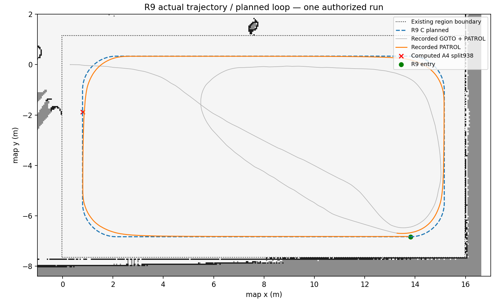
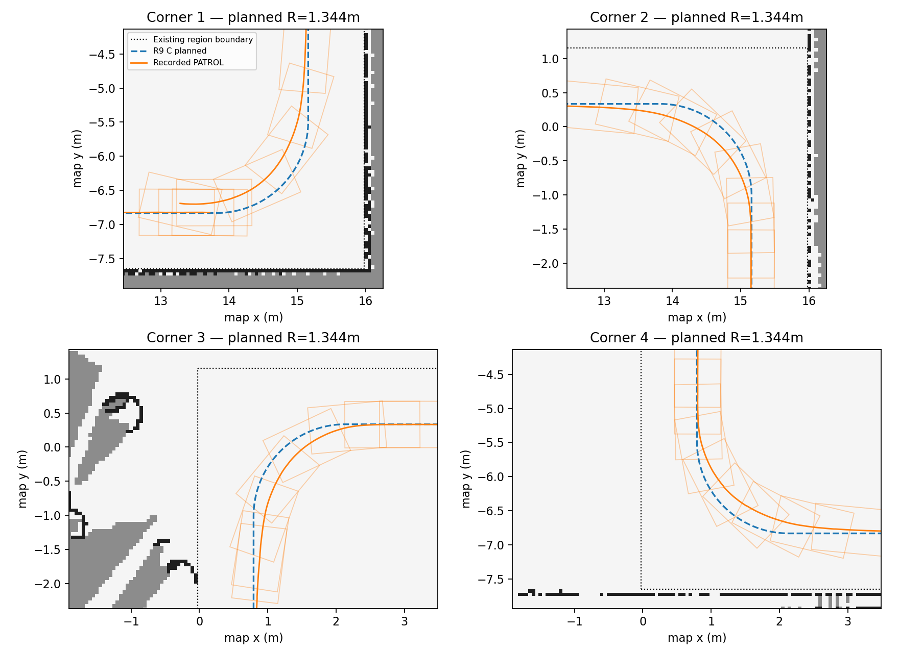
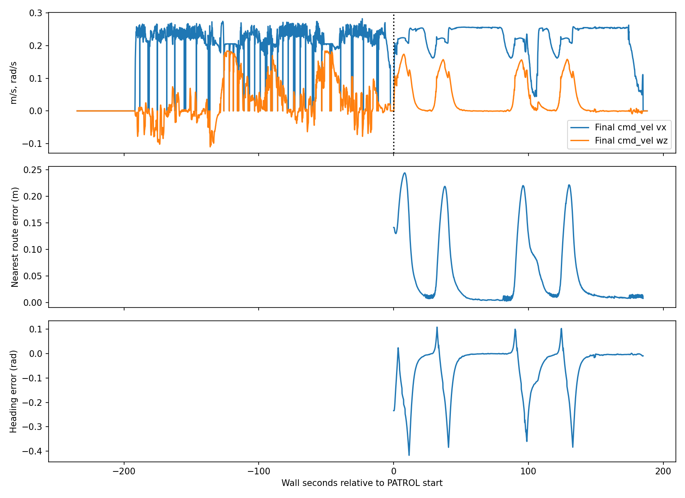
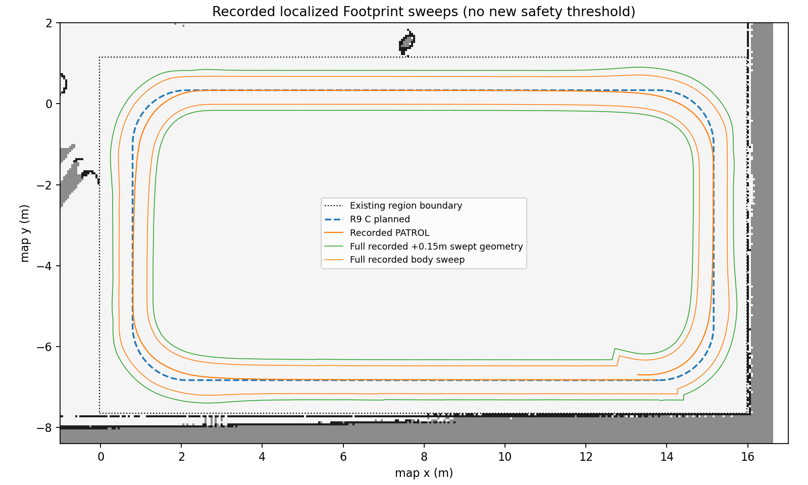

# R9 DYNAMIC RESULT

**VERIFIED SINGLE-LAP DYNAMIC PASS / REGULAR PATROL MODE FROZEN（限定范围）**。

本次只执行1/1次正式尝试，入口在新Session cwd执行 `bash run_patrol_lap.sh`，真实rc=0。SYSTEM READY、原3秒时钟门禁、唯一POST202、真实Lease、GOTO、两段PATROL/outer、MM与APP SUCCEEDED且completed_steps=2/2全部确认。无需、不允许自动第二次。

冻结范围：固定生产路径起点、正向ccw规则场地、C=1.344m、R8-A4原执行链；只证明本次完整Gazebo仿真单圈。**不宣称多圈统计鲁棒性、实车、任意起点/反向或非规则规划能力。**

## 身份与原始证据

- PR #4测试head：`f01b4df2564ce65e6bf5a1f72eb4254d8c97a83d`，base main `044e1842981df77ba0a03842dedccafd774872d9`；不修改/合并main。
- R9 **路径候选** identity：`25239cb9dec7c29e2939a7a6cc745f0a7b6daa355d030c43265dcd8f07404c4c`。
- R8-A4 **安装候选** identity：`6785d5a3b98447606d52b2cdb9b4600d5fb2b7416f852f3dcef37cd8033e68f5`，不改冻结install manifest中的历史PREP/路线字段；最终收据证明本次新运行。
- R9路径生成器是离线工具，**没有新的R9 ROS安装包**。本次保留A4 Navigation、RC MPPI、A2 Costmap、原MM/Safety/Gateway等11package prefix；只换路径和Registry。
- route SHA：`4d5f24a19600790eae561c4b17fc2ddbf032ed4d830efa81a42b257902cd03ea`；Registry SHA：`0aa2bcd552b8c87e54598f26751dde5a2ca315382018f5f1e2be3f36e3405032`。
- 地图identity：patrol_pillar_v1_mapping_v1 / 2026-11-02T16:33:45.687945+00:00 / `b09fd48018fa0e8b83aa24f66c76d8feec9dc5ab4d79633a2e1ea90743b4410f`。
- 地图DB前后：`e16e672a46ebd237a607bf8c34fb968f3f0479ea00fd0de6b40ed5a1d5df9bbd`；world、参数、Footprint、Keepout/Profile原样。818安装文件和27项运行资产前后SHA一致。
- [冻结组合](r9-dynamic/R9_FROZEN_COMPOSITION.json)、[Session绑定](r9-dynamic/evidence/SESSION_BINDING.json)、[机器验收收据](r9-dynamic/evidence/dynamic-validation-receipt.json)。

新Session：`/home/d1zzy/code/cleannav_modularization/cleannav-experiments/cleannav-patrol-r9-c-dynamic-20261106T112441Z/session-patrol-lap-1-r9-20261106T112441Z`，Domain224 / Gazebo11845 / Gateway18145；独立sequence/command/idempotency DB。Session已执行、已消耗，**不能重放**。runner/Observer绑定diff在evidence，还原必要替换后与A4最终成功版本逐字相等；source/export、FD9/SID、原时钟门禁、提交和清理逻辑保持。没有新Gate、外层preflight、Observer或启动入口。

Profile中patrol.route_sha256/1649是旧掩膜管道构造的历史说明，原prepare_profile/check_assets不据其选择执行路径；本次Profile/Mask不变。新Registry实际绑定R9路线，MM真实日志发送1637点，录包验证其坐标/yaw；不以旧说明冒充当前路线。

## 动态结果

| 检查 | 结果与证据 |
|---|---|
| SYSTEM READY | launch.log原READY完成，真实Adapters和Security READY |
| ROS Clock | stable 3.010s，7个不同MM时钟样本，门禁250ms/3s不变 |
| 唯一POST | 202 / accepted=true / replayed=false；新幂等库仅1记录 |
| Lease | 实际owner ros-execution-1、ros-execution-2；最终清空 |
| GOTO | SUCCEEDED；日志目标x13.815/y-6.832/yaw0，实际用新入口 |
| 第一段 | SUCCEEDED UUID `50703b8b125e47689f28af25d95fabf0` |
| 第二段 | SUCCEEDED UUID `28aec686dd7f426380ee350ac12e73be` |
| 外层FollowPath | SUCCEEDED UUID `8a4e04afd9a6411b8927f40ff743bcc1` |
| Mission Manager / APP | 均SUCCEEDED、completed_steps2/2，最终execution_id空 |
| 完整PATROL | 185.077s，实驶40.070m；设计闭环40.759629m；不能将current_lap1单独当成功 |
| Optimizer / LOST / ESTOP | Optimizer0、Localization LOST0、Security LOST0、保护ESTOP0、Facade NoneType0 |
| Keepout | 实时199全局+652局部独立verdict全PASS；核心253=0；原策略raw-bag回放196全局+642局部全PASS，header/update stamp不一致0 |
| MPPI时延 | 3714样本P50/P95/P99/max=7/14/16/21ms，loop missed0；仅原生computeVelocityCommands整数毫秒计时，不是全节点回调耗时 |
| 停车/清理 | 最后10条cmd_vel六分量全0，Safety可靠停车送达确认、Lease空；自有进程组退出、端口释放、锁可重新取得并释放、地图SHA不变 |

GOTO业务成功耗时191.998s、实驶40.961m、终态入口距离约0.549m。原stateful GoalChecker可先锁存XY再收敛yaw；**不得将此写成瞬时0.30m精度通过**。长绕行/停车到点精度仍是已知观察，不在本轮修改范围；本轮未调速度/GoalChecker/规划器。

## A4输入与交接

录包admitted_path实际1637点：最大XY误差0，最大wrapped yaw误差4.44e-16rad。安装版分段模块SHA870e5de1…，实际模块读取同一路线确定性输出 `((0,939),(938,1637))`，共享原Pose，无插点/yaw修改。**未记录原始inner FollowPath goal payload，938是确定性重建，不伪称直接payload观测。**

按inner accepted ROS stamp≥唯一outer accepted ROS stamp识别实际PATROL两段，排除GOTO重规划与延迟状态。两段均状态2→4；记录到第一段成功至第二段ACTIVE的消息间隔约0.059s，说明实际顺序交接，没有将几何连续性误说成全程不停。

| 终点重建 | 成功前最近位置误差m | 航向误差rad | 原0.10m/0.35rad联合样本 |
|---|---|---|---|
| 第一段index938 | 0.093712 | -0.111599 | 4 |
| 第二段index0 | 0.099011 | -0.009124 | 4 |

重建使用记录odom+此前收到的map←odom及静态base_link关系，不是controller内部Buffer查询或GoalChecker锁存遥测。[原始terminal证据](r9-dynamic/evidence/terminal-evidence.json)。

## 四弯、轨迹与净空

四个弯均完成，无MPPI优化失败或安全中断。设计圆角1.344m相对1.12m有20%半径裕度；这是**设计值**，不是声称实际车辆每时刻曲率都等于设计圆弧。保持G1相切而非G2连续，不引入新平滑框架。

PATROL记录定位轨迹1847样本：最近路线误差mean/P95/max=0.0565/0.2153/0.2440m。该误差为最近离散点距离，不新设跟踪数值门槛。完整车体和+.15m扫掠均在观测允许自由区和原边界内，与Keepout交集0。记录车体边界/Keepout净空=0.4341/0.9923m；+.15m净空=0.2401/0.8413m。此为记录定位坐标的离线几何重建，不是新增运行Gate或Gazebo接触传感器证明。

[等效动态回放GIF](r9-dynamic/figures/patrol-equivalent-replay.gif) 从真实录包轨迹/指令生成，明确不是Gazebo摄像机视频。原始rosbag保留167251968字节，含TF、odom、joint_states、plan、action、任务和Safety等原Topic，可进一步复放；未新增记录器或运行节点。

## 安全收尾与证据边界

Safety日志：`[SAFETY_SHUTDOWN] controlled stop published and reliably acknowledged; lease cleared; block_all=true`。这明确证明匹配底盘订阅者的零指令可靠送达，不把它伪称独立物理速度传感器。

实际末条odom vx=-0.000827584m/s、wz=0.002906874rad/s，最后1秒位移0.192305mm。Oracle真值末条同样有毫米级/毫弧度级接触抖动；**未观察到浮点严格全零物理速度**。最终零指令、停稳轨迹、原Safety可靠确认、Lease释放与进程退出构成原合同下的安全停车证据；没有新增/放宽数值阈值，也没有把命令全零冒充测量全零。

原cleanup.json保留domain224_holders=1（扫描自身继承Domain）；独立结束核验可读holder0、自有PID/组全空、端口11845/18145可bind、build.lock可取得/释放。仍有26个不可读环境，跨UID完整Domain空域UNKNOWN；cgroup UNKNOWN/WAIVED不改写为完整资源PASS。818安装文件与27运行资产SHA不变；旧A4产品/历史证据不覆盖。

正式运行无首错，无自动重试。继承的旧setup-hook缺失warning和正常SIGINT teardown警告保留，不能宣称整个日志无WARNING/ERROR。三个原离线分析器rc0，所有源脚本/argv/日志/结果收据保留；未修改产品或参数。UI终端创建0/复用0，工具托管会话已结束，无自有后台任务残留。

## 冻结结论与后续

本运行组合可按限定范围冻结为**R9规则场地正向单圈动态PASS**；原R8-A4安装仍执行本次任务，没有新编译/替换C++、新ROS包、A4/MPPI/Safety/Costmap/MM/Gateway修改。静态route.json中的motion_validated=false和冻结A4历史状态保持时间点证据，由本外部动态收据证明当前PASS，不改资产SHA冒充同一身份。

本Session已消耗1/1授权，后续任何动态须新Session和新明确授权。完成当前报告及SHA归档后，才进行用户授权的V1 Task Catalog/APP只读模式审计，不开放未启用任务、不新增ID/API/核心代码，不自动合并PR/main。

原始rosbag和完整日志保存在上述已消耗Session（167MB bag不提交Git）；[原始证据SHA清单](r9-dynamic/RAW_RUNTIME_SHA256SUMS)、[归档检查点](r9-dynamic/evidence/dynamic-archive-checkpoint.json)、[V1模式现状审计](../V1_MODE_ARCHITECTURE_AUDIT.md)。
