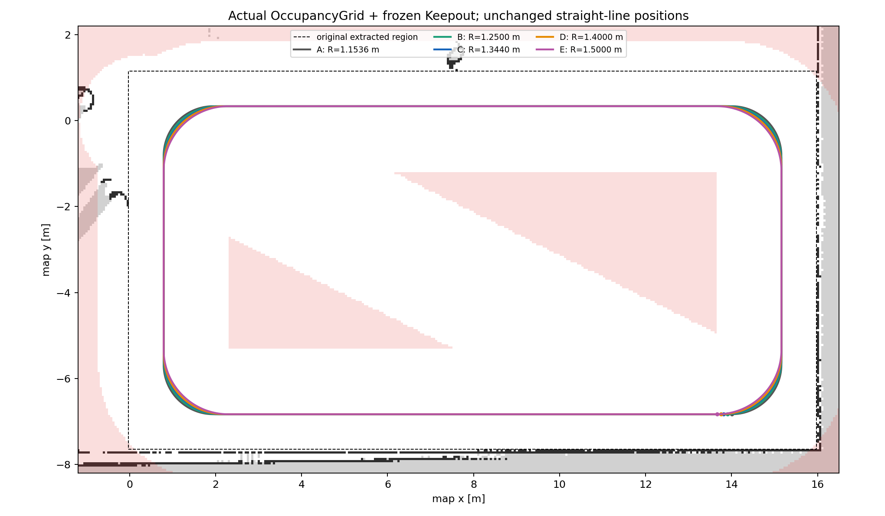
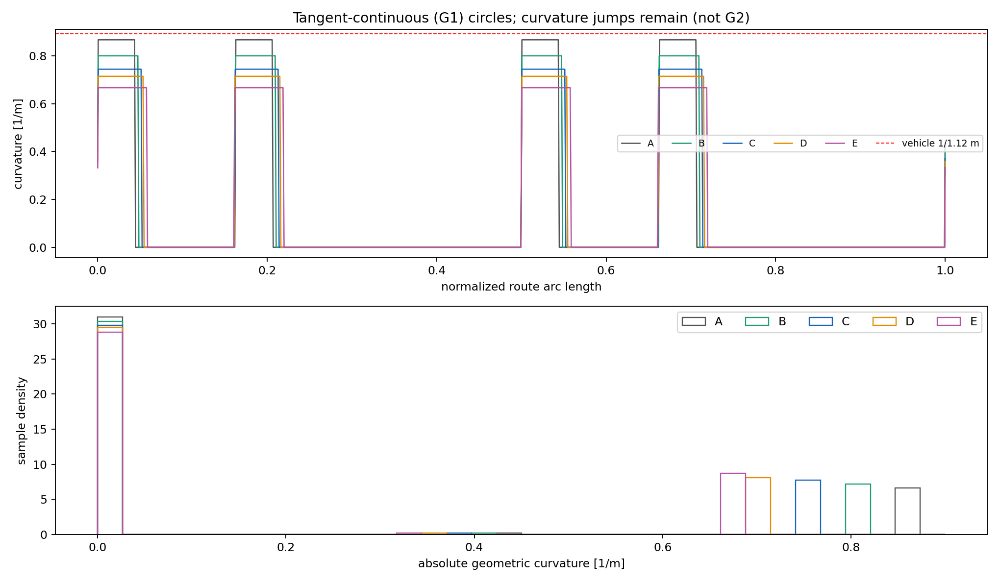
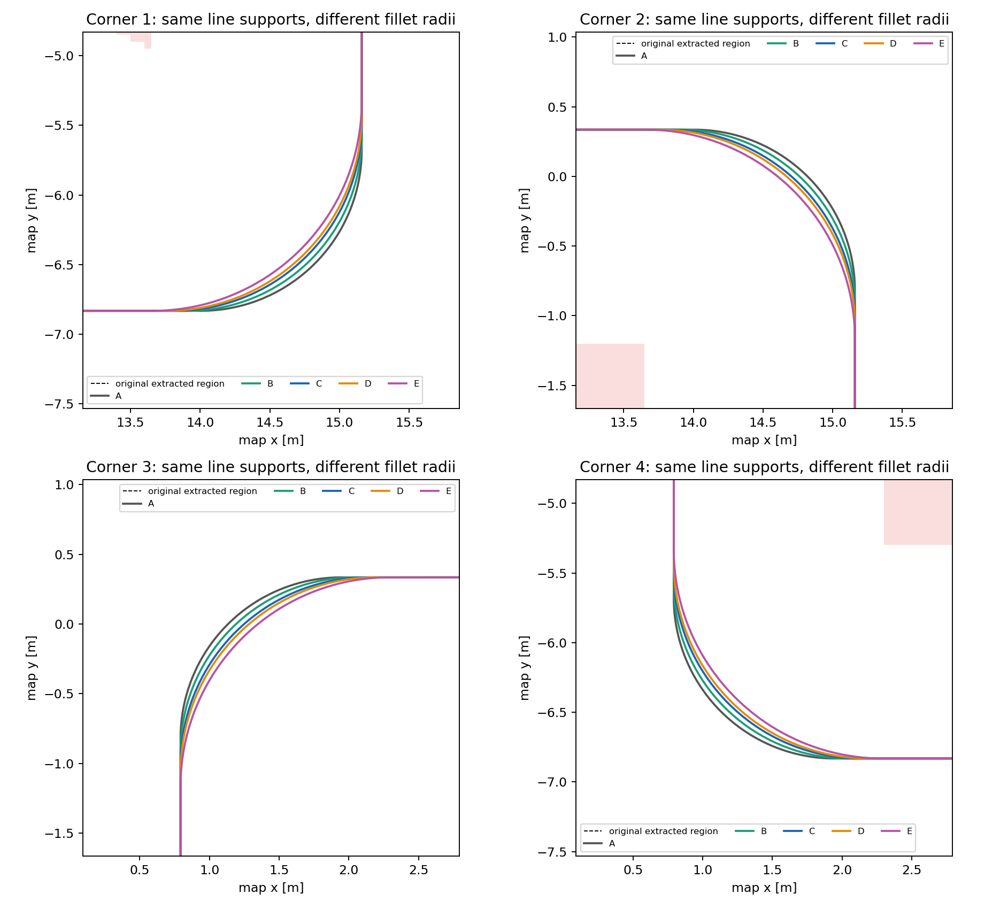
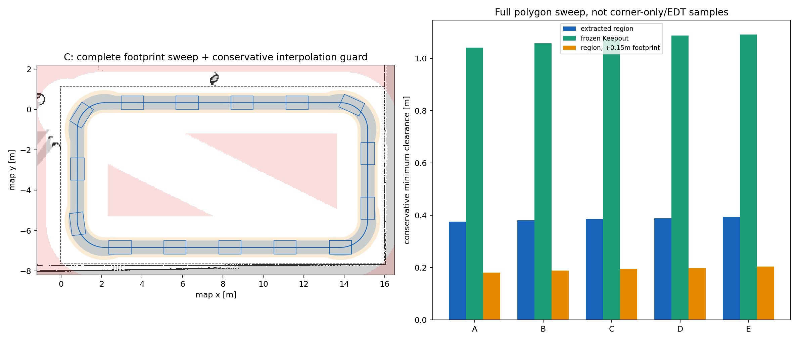
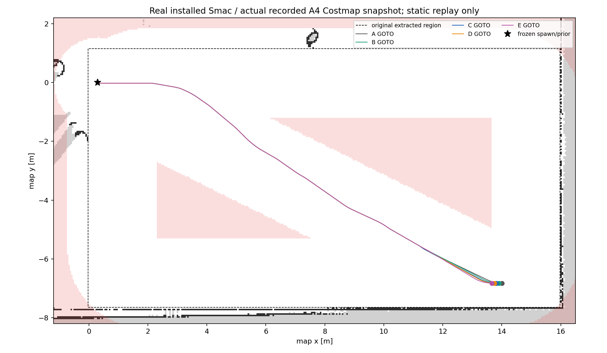

# R9 regular-site generation — offline candidate

**Current acceptance: PASS for the fixed production start and forward (ccw) C route. Dynamic tracking/lap: NOT RUN.** R8-A4 remains the formal dynamically validated baseline, with one complete simulated lap; multi-lap statistics and real vehicle validation are outstanding. The user explicitly scoped arbitrary starts/reverse routes out of this product candidate; the historical extra checks are retained as limitations and no longer treated as a release blocker. No A4 change is proposed.

## Source and implementation

Main `044e1842981df77ba0a03842dedccafd774872d9` already includes the R8-A4 release. A fresh independent branch `r9/regular-patrol-and-future-extension-20261106` was created from it. The prior R9 worktree, report and115 hashed artifacts are untouched. Current source commit is `368adb8d5e511b8ff0a4a27b2f5a17fef59d6ce3`.

The actual generator owner was non-Git `cleannav-tools/map-editor/core.py`. Its current source/UI/codec/tests are restored to `tools/map-editor`; see [source map](../../provenance/R9_MAP_EDITOR_SOURCE_MAP.json). Exact existing read-only map validator/Registry loader/schema snapshots make the offline tool portable. Vehicle geometry now reads the identical frozen YAML already in this checkout, instead of a historical worktree. These are packaging changes, with provenance, not runtime package/interface changes.

Only the route geometry policy changes:

```diff
-radius = model.vehicle['turning_radius']*1.03
+radius = model.vehicle['turning_radius']*1.20
```

The existing free-area extraction/largest interior rectangle, simplification, inward buffer, rounded_loop, .025m sampling, closure and Registry schema/flow remain. No MPPI/Costmap/Safety/Keepout/A4/Facade/Mission/Gateway changes. No new ROS interface/parameter/Gate or startup layer. [Exact owner-relative diff](r9/evidence/R9_SOURCE_DIFF.patch); Git PR diff additionally shows all restored/new files.

## Real inputs and geometry

Real map `patrol_pillar_v1_mapping_v1`, revision `2026-11-02T16:33:45.687945+00:00`, Occupancy SHA `b09fd48018fa0e8b83aa24f66c76d8feec9dc5ab4d79633a2e1ea90743b4410f`. Resolution .05000000074505806m,511×660, origin(-8.924291610717773,-8.59818172454834). The real occupancy connected free region and largest rectangle reconstruct the original1649-pose route exactly under the old owner; the explicit actual RC Keepout profile adds only≤1.78e-15m roundoff. Original raw assets and RTAB DB remain frozen.

Footprint `[[-.55,-.34],[-.55,.34],[.55,.34],[.55,-.34]]`, minR1.12m; frozen vehicle YAML SHA `389dbb6136d6b418d4e141368e1b4d6892e408107ac9465b0b3c763a44dee3ea`. Buffer remains **.8166065264130885m** = .6466065264130885m circumscribed radius + .15m safety margin + .02m original allowance. No extra inset is selected. RC Keepout mask SHA `f304a1dd109ec42ff49e8e19b8b615b33a760d30cc952b0e83033f10c839fbcc`,1300×739 with899822 forbidden cells; its algorithm/criterion is unchanged.

| Group | Design/actual R m | Radius margin vs1.12 | Max geometric curvature m⁻¹ | Poses | Length m | Short/long straight m | Body/boundary gap m | Body/Keepout gap m |
|---|---|---|---|---|---|---|---|---|
| A | 1.1536 | 3.00% | 0.866852 | 1649 | 41.0865 | 4.8596/12.0596 | 0.3756 | 1.0403 |
| B | 1.2500 | 11.61% | 0.800000 | 1641 | 40.9210 | 4.6668/11.8668 | 0.3812 | 1.0574 |
| C | 1.3440 | 20.00% | 0.744048 | 1637 | 40.7596 | 4.4788/11.6788 | 0.3861 | 1.0759 |
| D | 1.4000 | 25.00% | 0.714286 | 1629 | 40.6635 | 4.3668/11.5668 | 0.3888 | 1.0869 |
| E | 1.5000 | 33.93% | 0.666667 | 1625 | 40.4918 | 4.1668/11.3668 | 0.3932 | 1.0914 |

All five schemes have complete body and +.15m safety-expanded swept polygons within real allowed free space, boundary and outside Keepout. C body/boundary gap .386068m and body/Keepout gap1.075858m improve on A (.375617m/1.040336m). C padded/boundary gap .194583m and padded/Keepout gap .884289m are positive. The existing sweep includes a3mm conservative interpolation guard; the maximum sampled turn sagitta is≤.1042mm.

All four C circle radii reconstructed from XY geometry are1.344m to<1e-10m. Maximum geometric curvature is .744047619052m⁻¹, meeting .74405. The legacy yaw/chord finite-difference report is .744058206604m⁻¹; it is a sampling approximation, not the exact circle curvature. Both values are preserved, not silently replaced. Four line/arc joins are C0/G1 tangent-continuous with zero analytic heading error; **they are not G2 curvature-continuous**. No spline/clothoid or continuous-curvature implementation was introduced.

C closure XY/yaw errors0;1637poses; max step .0249546734735m. Straight support-line offsets relative to A<1e-12m; changed corners move inward with Hausdorff .0788568694m. Each straight is .3808m shorter than A, leaving4.478787m/11.678787m. C is the smallest compared radius achieving20%; D1.40m adds5 percentage points, shortens each straight another .112m and moves entry another .056m without a demonstrated need. E is not assumed best.









[Full metrics](r9/evidence/geometry-comparison.json).

## Entry, Registry and fixed-forward A4 compatibility

C entry changes from(14.00550223390805,-6.831575183979148,0) to(13.815102233908052,-6.831575183979148,0): **.1904m west, yaw unchanged**. The existing owner export and existing arc-length sampler regenerate both Registry and route, including16checkpoints and the existing path_file binding. No hand edits mask the change. Runtime loader validates map identity; loaded dense poses match route exactly. D's independent exporter roundoff8.88e-16m is recorded rather than altered.

Actual committed source produces C geometry to1e-12m against the reference. Frozen A4 SHA `870e5de1e5e75facdfea3d901b872b7ed40e434422d68ba65e3969a3511803bd` computes **`((0,939),(938,1637))`**, endpoint938, on the post-turn straight. Shared split Pose is the same original object, final path closes at the start, and both endpoint headings match their final straight tangent. This is a geometric/source compatibility result, not observed FollowPath success on the new route.

Historical wider analysis:66starts×2directions gave A132/132,B40/132,C40/132,D42/132,E42/132 for the stronger exact-straight criterion. C direct reverse can select a point24.84mm before the true tangent, lateral .229mm; its9.196mm last-tangent deviation legitimately passes unchanged A4's10mm near-straight predicate. These arbitrary-start/reverse routes are **outside the current product scope** per user decision. They are not patched away, represented as dynamic failures, or allowed to redefine fixed-forward acceptance.

Review assets: [C route](r9/C/route.json), [matching Registry](r9/C/region_registry.yaml), [loader consistency](r9/evidence/registry-consistency.json). `motion_validated=false` and `smac_validated=false` remain in route.json: the latter does not represent GOTO-only validation as SMAC planning of the whole dense patrol.

## Real SMAC static regression and receipt repair

The existing exact-SMAC replay was reused with only PlannerServer, static TF and LifecycleManager. No Controller/Localization/MM/Gateway/Safety/Gazebo, Lease or velocity exists in this static fixture. It uses the shared build.lock and original cleanup. Planner config remains SmacPlannerHybrid/DUBIN/144bins/minR1.12m/tolerance.5/allow_unknown=false/smooth_path=false with A2 Costmap selected. No new plugin/build or runtime Gate was added; the exact snapshot plugin was already installed.

Input is the actual A4 pre-POST global costmap, stamp51.9,511×660, SHA `0843751957f4b4e0caf40d8660531ff3a326b8f9db26c7e862430f7cc1f328bd`. To satisfy existing integer-metre Costmap2DROS dimensions it is padded to519×679 with UNKNOWN255 at the same resolution/origin; every original cell remains byte-identical, no free cells are added. Actual GetCostmap matches padded input SHA `98439d34771bb0e23a86f64322a5ed1941a413dc8896fce81881a515fa0641e3`. No reinflation/Keepout approximation replaces the frozen final costmap.

**Final new static run:5/5 A–E entry actions SUCCEEDED, coordinator rc=0, cleanup receipt saved, no survivors and lock released.** From(.3,0,0), C final plan XY error .016662m/yaw0rad; full body/+ .15m planned-path sweeps pass. This does not establish runtime GOTO tracking, dynamic obstacle response or patrol completion.

The historical coordinator typo `Path('/proc'/str(pid))` was changed to `Path('/proc')/str(pid)` only in the independent diagnostic copy. The original failed report/trace/executed code remain unchanged and archived; [exact fix](r9/evidence/coordinator-fix.patch), [corrected executed script](r9/evidence/replay_smac_entries.py.txt). The corrected full static run now verifies the receipt, rather than only inferring cleanup from missing processes.

This turn's first static run had a separate invocation error: a missing `share/cleannav_nav2_offline_probe/` segment in the source-hook path caused exact_snapshot plugin lookup failure and no plans (domain230, rc1). Its logs/cleanup are preserved. After confirmed owned-process exit and lock release, the known correct installed hook was used on fresh domain229; no product fix or blind same-entry retry. Existing A4 environment's missing old setup-hook warnings are retained in shell stderr.



Evidence: [inputs](r9/evidence/smac-input-provenance.json), [actual parameters](r9/evidence/smac-effective-parameters.json), [full actions/paths](r9/evidence/smac-entry-results.json), [readback](r9/evidence/smac-exact-input-readback.json), [cleanup](r9/evidence/smac-cleanup.json), [stdout](r9/evidence/smac-replay.stdout), [first error](r9/evidence/smac-first-first-error.json).

## Source tests and history

**184/184 pass**:166 unchanged A4 source tests +12 existing editor tests +6 real-Pillar regressions. A separately exported Git archive of source commit368adb8d5e511b8ff0a4a27b2f5a17fef59d6ce3 in `/tmp` also passes184/184 with no local project install/worktree imports. Only existing third-party Python dependencies were supplied via PYTHONPATH. Current package's default pytest paths include both suites. No C++ source changed, so no C++ build was required/run.

```bash
python3 -B -m pytest -q -p no:cacheprovider
```

[Test receipt](r9/evidence/archive-test-receipt.json), [independent source stdout](r9/evidence/archive-tests.stdout), [JUnit](r9/evidence/archive-tests.xml), [worktree run](r9/evidence/source-tests.stdout).

The historical10 setup errors were all caused by eagerly loading the old Campus map in shared class setup. Its52550 unknown cells used gray205 (free at threshold.25), and24677 free cells used254 instead of the current map validator's255;77227 pixels fail strict expected-image equality. The production loader's rejection remains. Frozen maps/DB/history are untouched. Exact compressed Occupancy/mask/old-PGM captures with source SHA now provide explicitly test-only models; demo, real-derived and projection provenance are separate. Original geometric assertions remain; only fixture binding and its test-only classification change. Tests also reproduce the old unknown-cell loss exactly. [Capture provenance](../../tools/map-editor/tests/fixtures/SOURCES.json), [historical failure](r9/evidence/historical-source-regressions.stdout), [original owner reproduction](r9/evidence/historical-legacy-editor-test-baseline-error.json).

This turn's first new test fixture lookup incorrectly used boundary_map instead of actual cruise_boundary (178pass/6setup errors); the test was corrected, with original output/JUnit retained. Geometry coordinator's missing new output parent and resource-path assumptions for radius-only copies were also retained as first/second errors. No product geometry or safety criterion was relaxed for these fixes. [First tests](r9/evidence/source-tests-first.stdout).

Future contract smoke check passes: import is stdlib-only, call raises NotImplementedError, no backend/route, and core does not import it. This is not an irregular-site planning test or claimed capability. [Smoke receipt](r9/evidence/future-contract-smoke.json).

## Future extension and source identity

The separate [irregular-site contract](../../tools/map-editor/future/README.md) reserves OccupancyGrid, full Footprint, map/Keepout, min radius and margin input and current route.json geometry fields. Status **NOT_INTEGRATED / FUTURE_EXTENSION**. Fields2Cover official BSD-3-Clause project, paper and decomposition/route/kinematic feature mappings are linked there. No third-party code copied, no Fields2Cover/GDAL/GEOS/OR-Tools installed, no production/UI/ROS import or integration, no irregular-site planning ability claimed.

C candidate identity: `25239cb9dec7c29e2939a7a6cc745f0a7b6daa355d030c43265dcd8f07404c4c` ([document](r9/C/candidate-identity.json)). SHA is canonical JSON (sort_keys=True, compact separators, ensure_ascii=True), not pretty-file SHA. It binds current generator/helper/vehicle/A4 sources and real route/Registry/map provenance; Git commits identify publication, not the dynamic binary baseline. Source changes from the earlier draft are packaging fixes; actual C XY/yaw remains unchanged. The new identity must not reuse consumed A4 authorization.

[Protection evidence](r9/evidence/protection-verification.json):392 frozen product files unchanged,17 protected userfiles unchanged,115 prior R9 artifacts unchanged. Main and R8-A4 tag are not modified. Final PR/publication IDs are recorded in the PR and local release report to avoid self-referential commit hashes.

## Next operation

This is a formal offline candidate for **the reviewed fixed start/forward route only**. No R9 dynamic session/env/runner was created. After review and separate explicit dynamic authorization, prepare a fresh independent session using the established A2/A4 runner/Observer/component/Lease/stop/cleanup contract. The only formal command remains `bash run_patrol_lap.sh` in that fresh session cwd, with no outer source/export or evidence/preflight entry. Never reuse the consumed A4 session. No automatic merge, deployment, dynamic test or irregular-site implementation follows this PR.

Diff whitespace check passes for product source, tests and documentation; verbatim archived logs/patch context retain their original whitespace warnings ([receipt](r9/evidence/diff-check.json)). Raw evidence was not reformatted to force a green full-archive check.
