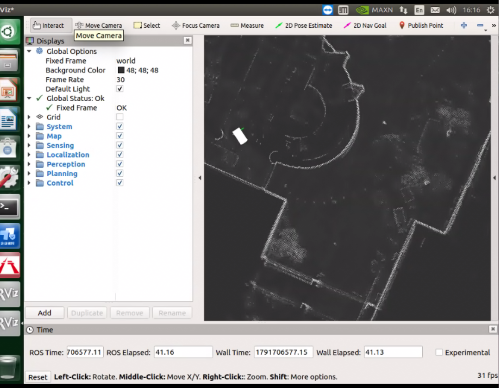

# 2026-10-11 Jetson 实车环境、相机排查与 Autoware 建图工作日志

## 范围与结论

本日志记录现场 Jetson / ROS 1 Autoware 的实际观测，不代表 CleanNav ROS 2 Humble / Nav2 已与该平台集成。当天已完成环境核对、离线备份校验、相机输入与采集链路排查，并保存建图 PCD。用户最后报告地图显示正常。相机仍未采集成功；导航处于地图点选目标的准备阶段，尚无定位与实车运动闭环证据。

文档归属为 `D1zzyhub7/cleannav-navigation`；`C:\CleanNav` 是 `cleannav-system` 多仓库工作区。本次文档提交不更新系统仓库的 submodule gitlink 或组件版本 pins，不提交运行日志、PCD、rosbag、私钥、备份源码或厂家资料。仓库 CONTRIBUTING 要求 main 为稳定基线、使用独立 feature 分支、共享历史不改写；本次使用 `feature/jetson-field-notes-20261011`。

## 环境与访问

| 项目 | 实测值 |
| --- | --- |
| 主机 / SSH 用户 | `ugv` / `xingshen001` |
| 现场地址 | `172.23.100.101` |
| 平台 | NVIDIA Jetson AGX Xavier |
| 系统 | Ubuntu 18.04.3，glibc 2.27 |
| 内核 / L4T | `4.9.140-tegra` / R32.3.1 |
| ROS | Melodic（ROS 1） |

现代 VS Code Remote SSH 的 glibc 要求与该环境不匹配，现场采用 SSH 与文件传输。已配置专用免密访问 key；文档只记录访问方式，不记录私钥或凭据。

## 备份与校验

Autoware 相关备份先位于 Windows Desktop，随后整理到 `C:\CleanNav\autoware_backup`。备份范围共 16 项，11,990 个文件，总计 1,333,318,857 bytes。rsync checksum 复核为 0 差异。范围排除 build、log、Git 元数据、bags 与密钥；这项校验证明所选范围的文件一致，不代表整台设备磁盘镜像。备份作为本地恢复资料保留，不上传仓库。

## 四路相机：输入正常与采图成功须分开判断

用户按物理位置从左至右标注：后视、前视、右前视、左前视。该顺序尚未对应到 UB960 RX、虚拟通道或 `/dev/video*`。

| UB960 | 已锁定输入 | 图像尺寸观测 | 输出观测 |
| --- | --- | --- | --- |
| I²C bus 30，地址 `0x30` | RX2 / RX3：lock=1、pass=1；RX0 / RX1 未锁 | 1080 行，3840 bytes/行；按 YUV422 推算为 1920×1080 | TX1 约 60–62 fps，TX0=0 |
| I²C bus 32，地址 `0x3d` | RX2 / RX3：lock=1、pass=1；RX0 / RX1 未锁 | 同上 | 同上 |

四路输入有同步和数据，不能据此认定 Linux 驱动已成功获得帧。

`/dev/video0..7` 默认报告 1824×940 UYVY；DTS 的 1920×1080 mode 定义 RGB888，尺寸与格式存在待核对项。第二颗 UB960 的 input VC0 映射到输出 VC2/3，而 video6/7 默认接 VC0/1；真实输入 VC 尚未测定，这是疑点而非已确认根因。

本地 `teachDesk相机配置文件/CameraInitForTP1.2/cameraConfigure.ini` 对应森云 390、1920×1080，未应用。启动示例使用的 i2c1 与现场实测总线不同，不能直接照抄运行。

### 授权的单设备试验与回滚

针对 video2 试验 1920×1080 UYVY，SET_FMT 被接受；单帧采集超时，输出 0 bytes，内核报告 capture release 失败。随后恢复 dimensions、pixel format 与 controls。colorspace 原 DEFAULT(0) 被驱动规范化为 SRGB(8)，因此不应声称逐字节完全还原。未修改 UB960 转发、VC、boot 或 DTS。

现场证据留存在 `/home/xingshen001/cleannav/camera_trial_20261011_144953`。本次结论是相机采图未修复，后续先查清 RX→VC→CSI→video 对应，再评估驱动配置。

## Autoware 感知入口

`xs_sensing.launch` 仅启动雷达。Runtime Manager 的 USB Generic 相机入口缺少 `uvc_camera`，原 `/image_raw` 无 publisher。CSI 相机可以经兼容 V4L2 的 ROS 节点接入，并不要求作为 USB 相机；但 ROS launch 无法替代底层成功采帧，需先解决驱动层问题。

## 建图异常诊断与最终产物

最初地图出现异常重影。实测 `/points_raw` 同时由 `rslidar_sdk_node` 实时发布和 `rosbag/play` 发布；离线建图须只保留 bag 输入，避免两条数据源混入。

`ring_ground_filter` 因输入缺少 `ring` field 崩溃，退出码 -11。实际点云 fields 为 X/Y/Z/Intensity。NDT 可直接使用 `/points_raw` 并执行内部体素采样；额外外部 voxel filtering 不等同于去地面。

一次 `method_type=2` 对照未产生 ndt_map 数据，同时采样到 `nvhost_syncpt` 等待。证据不足以确定 GPU 是根因，也不能据此声称已经切换并验证 CPU 路径。重播造成 TF 时间倒退一次属于回放时间重置的可预期现象。GTK 布局问题与 ROS log 超过 1 GB 不是已证实的 ring filter 崩溃原因。

用户最终报告地图正常，地面去除采用水平分组的 ray 方法。尚未证实 ray 节点此刻持续运行；ring 节点仅残留 master 注册且通信失败，不能将其描述为仍在工作。

保存产物已核实：

| 项目 | 值 |
| --- | --- |
| 文件 | `/data/datalog/mapping_test_261011_zhang/autoware-261011.pcd` |
| 大小 | 12,099,619 bytes |
| 编码 / fields | ASCII / XYZIntensity |
| 点数 | 338,850 |
| 最后观测 `use_sim_time` | false |

PCD 保留在现场设备，不纳入 Git。截图仅辅助说明用户最终地图显示状态，不能代替定位、规划或运动验证。

## 下一步：地图点选目标导航

用户选择在地图上点选目标。现场没有 vector map；Autoware 的 `astar_navi` 可使用栅格、当前 pose 和 `/move_base_simple/goal`，无需先构造车道向量地图。默认 24×12 m costmap 为局部范围，点到点路线评估需要覆盖目标范围的全局可通行栅格。

截至本日志证据，尚未有 `ndt_matching` / `/current_pose` 定位闭环。下一步先准备地图、定位与规划输入，核实 frame、地图范围和可通行区域，观察路径输出；本日志不宣称车辆已经自主行驶。

CleanNav 的 ROS 2 Humble / Nav2 与 Jetson 当前 ROS 1 Autoware 属于不同架构。后续桥接、迁移或控制接口需单独设计与验证。

## 验证与未闭环项目

本次文档验证：比对现场事实清单；检查只有 Markdown 与已选截图进入提交；检查相对图片链接；检查 Git whitespace；未更改运行节点、参数或代码，未更新 system pins。没有执行 ROS 2 build/test，因为此次为文档记录，不能以代码测试代替现场验证。

仍待闭环：相机实际 VC 与 video 对应、底层有效采帧、物理视角映射、ray 节点当前运行状态、CPU/GPU 单变量对照、NDT 定位、全局可通行栅格与点选规划，以及实车控制接口。
